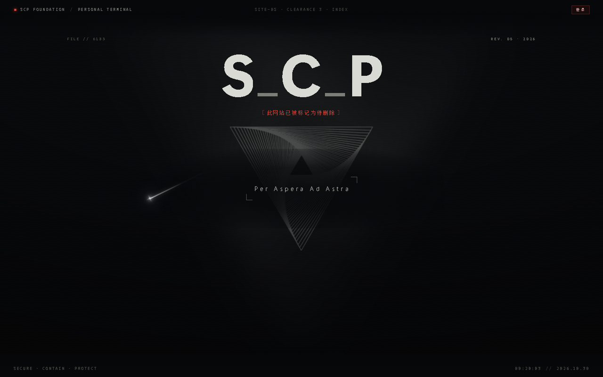
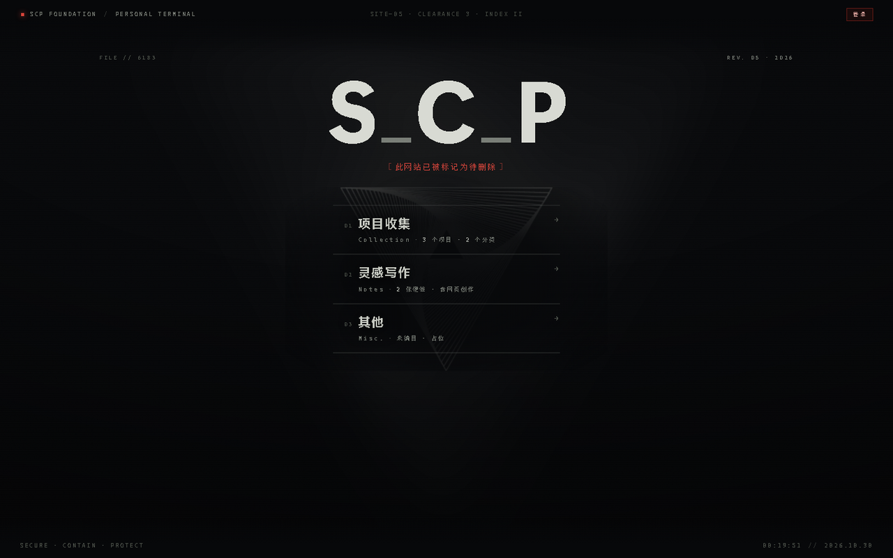
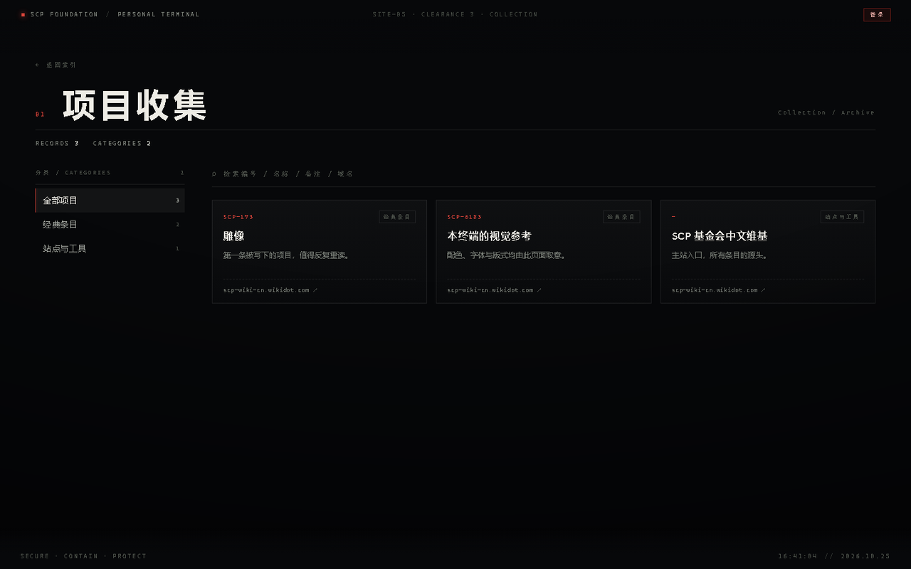
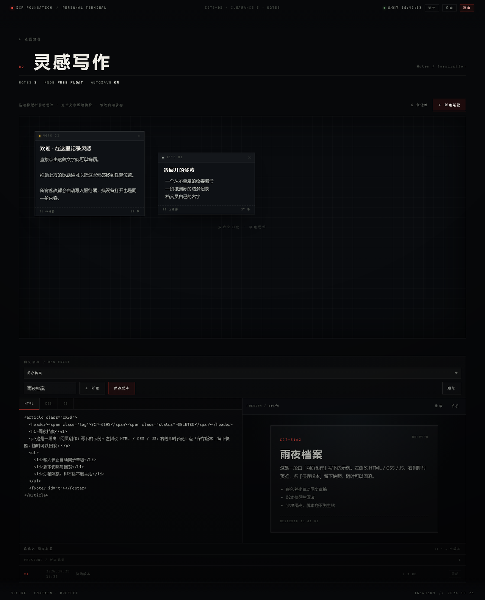

# S_C_P · SCP 基金会主题个人档案站

> 一个有后端的个人站点：收藏 SCP 条目、摊开灵感便签、直接写网页。只有所有者能登录编辑，其他访客只读浏览；每天的访客数会被记录，每月自动归档。

| 首页 · `/` | 次页 · `/stage/` |
| :---: | :---: |
|  |  |

| 项目收集 | 灵感写作 + 网页创作 |
| :---: | :---: |
|  |  |

---

## 它是什么

一个写给自己用的 SCP 档案终端。视觉取 [SCP-6183](https://scp-wiki-cn.wikidot.com/scp-6183) 的档案气质：近黑底色、骨白正文、等宽字体只用于编号与状态这类「机读注记」，警示红只出现在危险处。

与第一版（纯静态、数据存在各自浏览器）不同，这一版是**真实的服务端应用**：

- 内容存在服务器上，所有人看到同一份；
- 只有所有者登录后能改，写接口在服务端强制校验；
- 首页与次页共用一套骨架：首页中央是一句 `Per Aspera Ad Astra`，点击进入次页，次页把这句话换成三个板块入口；三个板块再各自独立成页；
- 访客统计只在所有者登录后可见。

## 功能

| 页面 | 路由 | 能做什么 |
| --- | --- | --- |
| **首页** | `/` | 大字 `S_C_P` 字标、红色待删除标记、中央递归徽记；一句 `Per Aspera Ad Astra` 叠在徽记中心，句子的左下角与右上角各浮出一个半角方框；悬停句距拉开、出现细线，点击进入次页。小流星持续斜落，约每半分钟一颗大流星 |
| **次页** | `/stage/` | 与首页同一套骨架，只把这句换成一竖排三入口（编号 / 板块 / 计数）；**没有流星** |
| **项目收集** | `/archive/` | 自建分类（可删，条目自动落入「未分类」）、条目增删改、按编号/名称/备注/域名检索、按分类筛选 |
| **灵感写作** | `/writing/` | 浮动便签：拖动、置顶、就地编辑、自动保存；**网页创作用于便签下方**：HTML/CSS/JS 三标签 + 沙箱实时预览 + 版本快照 + 回滚 |
| **其他** | `/other/` | 预留板块：三个占位槽 + 可编辑备注 |
| **访客统计** | `/stats/` | 今日 / 当月 / 总计 UV、近 30 天柱状、历史月度列表（仅所有者） |

**权限模型**

- 所有者：邮箱 + 密码登录（scrypt 加盐、httpOnly Cookie），可编辑全部内容、查看统计。
- 访客：无需登录，只能读；所有写接口对匿名请求返回 401，前端隐藏编辑按钮只是顺带的 UX。
- 网页作品只对所有者可见，预览在 `sandbox` 不透明源里渲染，脚本碰不到主站。

## 快速开始

```bash
# 1. 配置（首次）
cp .env.example .env
#    编辑 .env：填 OWNER_EMAIL / OWNER_PASSWORD，并替换三个密钥
#    生成随机密钥：node -e "console.log(require('crypto').randomBytes(32).toString('base64url'))"

# 2. 初始化所有者账号与示例内容
npm run seed

# 3. 启动
npm start          # 或 npm run dev（文件监听）
# 打开 http://localhost:8787
```

没有 `npm install` 这一步——服务端零第三方依赖，只用 Node 内置模块（`node:http` / `node:crypto` / `node:fs`）。要求 Node ≥ 20。

> 首次打开会写入 2 条示例便签、3 条示例条目和 1 个示例网页作品，可直接在界面里删除。

## 登录与权限

点右上角「登录」，输入 `.env` 里的邮箱与密码。登录成功后：

- 顶栏出现「统计 / 导出 / 退出」，保存状态灯变为绿点；
- 各页出现新建、编辑、删除、拖拽等操作；
- Cookie 为 `HttpOnly` + `SameSite=Lax`，生产环境自动切到 `__Host-` 前缀并要求 HTTPS。

改口令：`OWNER_PASSWORD=新口令 npm run seed -- --reset-password`（会吊销全部会话）。

## 数据与备份

- 本地默认存储在 `data/db.json`（文件驱动，写入走临时文件 + rename 原子替换）。
- 顶栏「导出」可下载整份 JSON（`/api/export`）；「导入」接受同样的 JSON（`/api/import`，支持 replace / merge）。
- `data/` 已在 `.gitignore` 里，不会被提交。

## 目录结构

```
.
├── public/                     纯静态前端（零构建）
│   ├── index.html              首页（拉丁句 + 流星）
│   ├── stage/index.html        次页（三入口，无流星）
│   ├── archive|writing|other/stats/   各板块独立页面
│   └── assets/
│       ├── css/                base + 每页一份 + meteor/studio/stats
│       ├── js/
│       │   ├── boot.js         每页唯一入口
│       │   ├── core/           api / store / saver / nav / track / ui
│       │   ├── ui/             shell / guard / modal / page-head
│       │   ├── modules/        welcome / meteors / notes-board / studio
│       │   └── pages/          home / stage / archive / writing / other / stats
│       └── sigil.png  source/  徽记与原始素材
├── server/
│   ├── server.js  app.js  config.js
│   ├── routes.js              全部端点与鉴权声明
│   ├── auth.js                会话、口令、Cookie
│   ├── content.js  works.js  stats.js
│   ├── storage.js             文件驱动（内存 + 原子落盘）
│   └── util.js                加密 / 时间 / 校验 / Cookie
├── scripts/seed.js            初始化与重置口令
├── test/api.test.js           鉴权、内容、作品、统计冒烟测试
├── data/                      运行时数据（gitignore）
└── Dockerfile
```

## 接口一览

前缀 `/api`，统一返回 `{ ok, data }` 或 `{ ok:false, error:{ code, message } }`。

| 分组 | 端点 | 权限 |
| --- | --- | --- |
| 会话 | `POST /auth/login`、`POST /auth/logout`、`GET /auth/session`、`POST /auth/password` | 公开 / 所有者 |
| 内容 | `GET /content`（ETag）、`GET /content/summary`、`GET /export`、`POST /import` | 读公开，写所有者 |
| 分类 | `POST /categories`、`PATCH /categories/:id`、`DELETE /categories/:id` | 所有者 |
| 条目 | `GET /items`、`POST /items`、`PATCH /items/:id`、`DELETE /items/:id` | 读公开，写所有者 |
| 便签 | `POST /notes`、`PATCH /notes/:id`、`PATCH /notes/:id/geometry`、`DELETE /notes/:id` | 所有者 |
| 设置 | `PATCH /settings` | 所有者 |
| 作品 | `GET/POST /works`、`GET/PATCH/DELETE /works/:id`、`PUT /works/:id/draft`、`POST/GET /works/:id/versions`、`POST /works/:id/rollback` | 所有者 |
| 作品预览 | `GET /w/:id/preview`（独立沙箱文档） | 所有者 |
| 统计 | `POST /track`（永远 204，不回任何数字）、`GET /stats/overview`、`/stats/daily`、`/stats/months` | 公开写，所有者读 |

**安全要点**：写请求必须带 `X-CSRF: 1` 且 `Content-Type: application/json`，并校验 `Origin`；`/api` 不返回任何 CORS 头；主站 CSP 为 `default-src 'self'`，脚本只允许同源（样式允许内联，因为便签坐标需要 `style` 属性）。

## 访客统计怎么算

- **UV**：同一浏览器一天只计 1 次（`localStorage` 里的 `scp_vid` → 服务端 HMAC 成不可逆键 → 唯一键「当天+访客」插入成功才 +1）。
- **PV**：每次打开页面都 +1。
- 日界按 `Asia/Shanghai` 计算，不受服务器时区影响。
- 月度计数按「一个月一个文档」存：跨月只是写新 key，**天然归零**；归档 = 给旧月文档打 `archived` 标记，历史列表直接读这张表。
- 所有者自己的访问默认只计 PV、不计 UV（`STATS_EXCLUDE_OWNER=true`）。

## 交互细节

- 整页跳转是 8 片竖向幕布收拢 → 换页 → 展开；支持 `@view-transition` 的浏览器会做原生交叉淡入。
- 首页与次页共用一个视图，只差中央一块：首页是 `Per Aspera Ad Astra`（整块可点，链接到 `/stage/`），次页是三个入口。顶部元信息、字标、红色标记、徽记、指针视差完全一致。
- 流星斜落（与水平线 10°–34°），头部是星核 + 十字星芒 + 呼吸微闪，拖尾用一张亮度→透明度处理过的星轨精灵，纵向柔化靠图片自身的衰减，所以是「一道光」而不是一条直线。
- 大流星（约每 20–40 秒一颗）带光晕，以 1150–1650 px/s 掠过；轨迹有 62% 的概率反推起点让它**正好穿过中央那句话**，否则效果基本看不到。沿途进入 52px 半径的小流星会被当场吞掉，留一瞬闪光。
- 照亮是**真的照亮**：`.glare` 是整页内容的克隆层（白字 + 更强光晕 + 一小片曝光池），用径向遮罩跟随流星头部；透明度按「头部与句子的距离」做包络（380px 内渐亮、飞远渐暗），不是叠一层光斑。没有大流星时指数衰减回零。
- `prefers-reduced-motion` 下不生成流星、跳过幕布与全部位移动效；入场动画默认不播，只有确认可动效才挂上 `html.motion`，所以关掉动效也不会白屏。

## 测试

```bash
npm test
```

覆盖：匿名访问 17 个写接口全部 401、跨站 Origin 403、非 JSON 415、登录与 Cookie、内容写入与 ETag、作品版本只追加 + 回滚、预览沙箱 CSP、同访客同日 UV=1 / PV 累加、月度列表。

## 部署

### 方式一：自有服务器 / 本机常驻

```bash
NODE_ENV=production PORT=3000 PUBLIC_ORIGIN=https://your.domain \
COOKIE_SECURE=true COOKIE_NAME=__Host-scp_sid TRUST_PROXY=true \
node server/server.js
```

前面挂 Nginx 反代并终止 TLS 即可。**注意必须让页面与 `/api` 同域**，否则 Cookie 会失效。

### 方式二：腾讯云 CloudBase（云托管）

```bash
docker build -t scp-web .
# 用 CloudBase CLI 推到云托管，环境变量同上，端口 3000，最小实例 0 / 最大实例 1
```

需要你本人完成（按顺序）：

1. 注册腾讯云并完成**实名认证**（免费，必须）。
2. 开通云开发 CloudBase、创建环境——**按量计费**，个人站量级通常个位数元/月。
3. 「云托管」部署镜像，配置环境变量（`SESSION_SECRET` / `AUTH_PEPPER` / `STATS_SECRET` 必须换成随机 32 字节）。
4. **持久化**：容器内 `data/` 是临时的，重部署会丢。要么挂持久卷，要么接入云数据库驱动（见「已知限制」）。
5. 自定义域名：**【花钱】** 约 ¥30–100/年；境内节点绑定自有域名还需 **ICP 备案**（免费，1–20 个工作日）。不买域名也能先用平台默认域名跑通。
6. 设一个 ¥10/月的预算告警。

## 已知限制

- **云端存储驱动尚未接入**：当前只有文件驱动。部署到无状态容器时必须挂持久卷，否则重启丢数据；`STORAGE_DRIVER=cloudbase` 会明确报错而不是静默丢数据。
- 网页作品仅私有，公开展示（`/w/:id` 只读页）留待下一版。
- 统计为单实例内存限流 + 文件计数，多实例部署需要换成共享存储。
- 主站允许内联样式以支持便签坐标，脚本仍严格限制同源。

## 声明

个人非官方作品，与 SCP 基金会官方无关。SCP 基金会系列内容遵循 **CC BY-SA 3.0**，站内链接均指向 [SCP 中文维基](https://scp-wiki-cn.wikidot.com/)。
